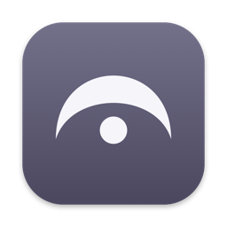

<p align="center"></p>

# FermataNeo

A native Apple Silicon menu bar app that keeps a Mac awake on demand, including with the
**lid closed, on battery, and with no external display**.

It is a Swift rewrite of the idea behind [Fermata](https://github.com/iccir/Fermata) by
Ricci Adams, whose released build is Intel-only and needs Rosetta.

## Features

- **Prevent Sleep** until you turn it off, or for 30 minutes, 1, 2 or 4 hours.
- **Works with the lid closed** on battery, with nothing plugged in.
- **Crash safety:** if the app quits, crashes or is killed, normal sleep comes back by itself.
- **Battery threshold:** stops at a battery level you choose (5% by default).
- **Overheating protection:** stops when macOS reports the Mac is running hot.
- **Keep Display Awake** (optional) and **Launch at Login**.

## Requirements

- An Apple Silicon Mac. The app is built for macOS 13 or later, but has only been
  tested on macOS 27.2 (M1 Pro).
- The Xcode Command Line Tools (`xcode-select --install`). Full Xcode is not needed.
- An administrator password, once, to install the helper.

## Build and install

```bash
git clone https://github.com/EthanChant/FermataNeo.git
cd FermataNeo
./scripts/build.sh
```

This produces `build/FermataNeo.app`, built for arm64 and ad-hoc signed. Copy it to
`/Applications` and open it:

```bash
cp -R build/FermataNeo.app /Applications/
open /Applications/FermataNeo.app
```

The first time you choose **Prevent Sleep**, the app offers to install its helper and
macOS asks for your password.

## Using it

FermataNeo lives in the menu bar and has no Dock icon.

| Menu bar icon | Meaning |
|---|---|
| `zZ` above a line | Sleep is allowed. Closing the lid puts the Mac to sleep as usual. |
| Arc over a line with a green dot | Sleep is being prevented. |

| Menu item | What it does |
|---|---|
| **Prevent Sleep** | The main switch. Ticked whenever prevention is on; click to turn it off. |
| **Prevent Sleep For ▸** | Starts a timed session. The submenu and the chosen duration are ticked while it runs. Clicking the ticked duration removes the timer and keeps prevention on until you turn it off. |
| **Keep Display Awake** | Also stops the screen from turning off. |
| **Stop at N% Battery ▸** | The battery threshold: Off, 5, 10, 15, 20 or 30%. |
| **Overheating Protection** | See below. |
| **Launch at Login** | Starts FermataNeo when you log in. |
| **Install / Uninstall Helper…** | Adds or removes the background helper. |

**Prevent Sleep** ticked on its own means "until turned off". The three session options
(display, battery, overheating) are greyed out while sleep is allowed, because they only
apply during a session.

## Safety

A closed laptop that stays awake in a bag can overheat or run its battery flat. FermataNeo
has four guards against that. Prefer the timed options when you can.

- **Timer.** A timed session ends by itself.
- **Battery threshold.** While unplugged, prevention stops when the battery reaches the
  chosen level, and it will not start below it.
- **Crash safety (dead-man switch).** The helper keeps sleep disabled only while the app
  holds its connection open. If the app quits, crashes or is force-killed, the helper
  restores normal sleep within a second or two. It also restores it at boot and when it
  is stopped. One case is not covered: an app that freezes without exiting.
- **Overheating protection.** With **Overheating Protection** ticked (the default),
  prevention stops when macOS reports its thermal state as serious or critical, and will
  not start in those states. It keeps going in nominal and fair.

  | macOS thermal state | Meaning | FermataNeo |
  |---|---|---|
  | Nominal | Within normal limits | Keeps preventing sleep |
  | Fair | Slightly elevated; fans may be audible | Keeps preventing sleep |
  | Serious | High; fans at full speed, performance may be reduced | Stops |
  | Critical | Performance significantly affected; the Mac needs to cool down | Stops |

  Apple publishes no temperatures for these states; macOS derives them from its own
  sensors. "Serious" means the system is already throttling, so for a laptop in a bag
  the timer and the battery threshold are the more dependable guards.

When a guard ends a session, the menu shows the reason, for example
"Stopped: battery reached 5%".

## How it works

macOS has one setting that stops a lid-close sleep: the system power setting
`SleepDisabled`, the same one `sudo pmset disablesleep 1` changes. Only root can change
it. The public keep-awake APIs (what `caffeinate` uses) block idle sleep but not a closed
lid, and kernel extensions are not an option on Apple Silicon.

FermataNeo is therefore two programs:

- **The menu bar app** runs as you. It owns the menu, the timer and the safety checks,
  and holds an ordinary assertion that blocks idle sleep during a session.
- **The helper** (`local.FermataNeo.Helper`) is a small root launch daemon. Its only job
  is to switch `SleepDisabled` on or off when the app asks over XPC.

The helper is installed to `/Library/PrivilegedHelperTools` with a launchd plist in
`/Library/LaunchDaemons`.

## Limitations

- **Private API.** Changing `SleepDisabled` uses an IOKit call Apple does not document or
  support. It has been tested on macOS 27.2 only, and could break in a future release.
- **The helper trusts any local process.** The app is ad-hoc signed, so the helper cannot
  verify its caller by signature. All it can do is toggle `SleepDisabled`.
- **It shares one system setting with other tools.** FermataNeo sets `SleepDisabled` back
  to off whenever it stops, quits, or its helper starts. If another app (some battery or
  keep-awake utilities do this) had disabled sleep, that hold is cleared too.
- **Waking a sleeping Mac is unchanged.** With the lid closed on battery, plugging in a
  display does not wake a Mac that is already asleep; that is macOS behaviour. Turn
  prevention on before closing the lid, or connect power.
- **Not notarised.** If you download a build instead of compiling it, Gatekeeper will
  block it until you allow it.

## Uninstalling

Choose **Uninstall Helper…** from the menu, quit the app, and delete it. To remove the
helper by hand:

```bash
sudo sh Resources/uninstall-helper.sh
```

## Development

- `scripts/build.sh` calls `swiftc` directly, so it needs neither Xcode nor SwiftPM.
- `scripts/make-icon.sh` regenerates `Resources/AppIcon.icns` from `scripts/make-icon.swift`.
- Start with prevention already on:
  `open build/FermataNeo.app --args -StartActive YES`
- Set a custom battery threshold:
  `defaults write local.FermataNeo BatteryFloorPercent -int 12`

| Path | Contents |
|---|---|
| `Sources/FermataNeo` | The menu bar app |
| `Sources/FermataNeoHelper` | The root helper |
| `Sources/FermataNeoShared` | The XPC protocol both sides use |
| `Sources/PowerSPI` | Declarations for the private IOKit calls |
| `Resources` | Info.plist, icon, helper plist and install scripts |

## Credits

The mechanism and the name come from [Fermata](https://github.com/iccir/Fermata) by
Ricci Adams. FermataNeo shares no code with it.
